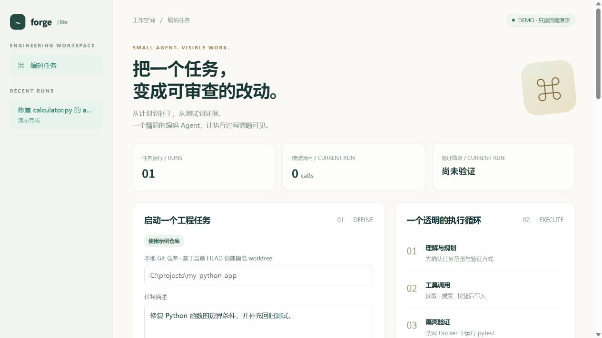
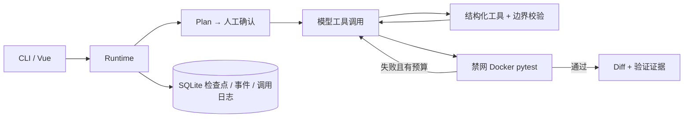

# Forge Agent Lite

**把一个工程任务变成可审查的改动。** 一个精简、可观察的 Python 编码 Agent：计划确认、工具调用、隔离测试、有限修复、Diff 交付。

[](https://github.com/whitecathu/forge-agent-lite/actions/workflows/ci.yml)
  



## 关键能力

- CLI 与轻量 Web 共用 LangGraph 运行时；先展示计划，再由用户启动执行。
- 六类结构化工具：列文件、读文件、文本搜索、带 SHA256 前置条件的文件更新、容器测试、Diff 查看。
- 每个任务使用独立 Git worktree，源仓库未提交内容不进入任务。
- SQLite 检查点与调用日志；完成的工具调用复用结果，执行中断但结果不明时拒绝盲目重放。
- 最多 20 次模型调用、2 轮失败修复；失败、预算耗尽、暂停与验证不可用均保留明确状态。
- 测试只在禁网、只读挂载、限资源 Docker 容器内执行；无任意主机 shell 工具，不自动 commit/push。
- 12 个自包含 Python 编码评测任务与独立验收测试。

默认 `DEMO_MODE=true` 只运行确定性的只读流程，状态为 `demo_complete`，不会修改代码、调用真实模型或模拟测试通过。真实模式没有密钥时直接失败，不会回退到演示。

## 本地启动

需要 Python 3.11+、Node.js 22+、uv、Git；真实测试还需要正在运行的 Docker 引擎。

```bash
uv sync --frozen
npm --prefix web ci
npm --prefix web run build
uv run forge serve
```

打开 **http://127.0.0.1:8001**，点击“使用示例仓库”，生成并确认计划，查看工具轨迹、Diff 与验证页。示例仓库由本项目原创，不会使用你的其他项目。

复制 `.env.example` 为 `.env`：PowerShell 使用 `Copy-Item .env.example .env`，其他 shell 使用 `cp .env.example .env`。

### 真实编码任务

设置 `DEMO_MODE=false` 和 `LLM_BASE_URL`、`LLM_API_KEY`、`LLM_MODEL`。API 必须支持 Chat Completions 的 function tools；不支持的服务商会明确报错。

先构建测试镜像（此步骤联网下载依赖，任务测试本身禁网）：

```bash
docker build -t forge-runner:local runner
uv run forge run /absolute/path/to/trusted-python-repo "Fix the bug and add regression tests"
uv run forge start RUN_ID
uv run forge show RUN_ID
```

也可使用 `run ... --approve` 明确批准生成的计划。`forge cancel RUN_ID` 在工具边界暂停，`forge resume RUN_ID` 继续。Web 与 CLI 不应同时执行同一个任务；当前仅保证同一进程内互斥。

内置 runner 仅含 Python 与 pytest；需要额外依赖时，先基于 `runner/Dockerfile` 构建自己的镜像并设置 `RUNNER_IMAGE`。运行期间不会联网安装依赖。

### 容器化 Web 演示

`docker compose up --build` 启动只读演示工作台。使用页面中的示例仓库。Compose 不挂载 Docker socket，因此真实编码测试使用主机 CLI/API 搭配独立测试容器。

## 检查与评测

```bash
uv run ruff check .
uv run pytest -q
npm --prefix web test
npm --prefix web run build
uv run python -m evals.run
```

默认最后一个命令只验证 12 个样例是否齐全，报告 `task_success_rate: null`。配置模型与费用预算后显式运行：

```bash
uv run python -m evals.run --live --limit 1 --max-calls 10
```

确认单个任务的实际用量后再扩大至 12 个。完成率要求运行时验证和外部验收同时通过；只跑 fixture 检查或 scripted 单元测试不代表真实模型任务完成率。

真实 Docker 集成检查：设置环境变量 `FORGE_DOCKER_TESTS=1` 后执行 `uv run pytest -q tests/test_docker.py`。

## 架构



## 使用边界

这是本地单用户工程项目，不是可暴露公网的托管 Agent。使用可信 Git 仓库；worktree 隔离不是针对恶意宿主仓库配置的完整沙箱。Docker 隔离只覆盖测试进程。恢复对“已记录完成”的工具去重，无法承诺外部副作用的全局 exactly-once；结果不明的调用必须人工检查。

运行数据和 worktree 保留在 `.data` 供审查，不自动清理或合并。模型请求包含任务与工具读取的代码；运行前确认允许发送给配置的模型服务商。测试通过只说明本次测试满足断言，不能证明业务代码没有其他缺陷。

[架构与接口](docs/ARCHITECTURE.md) · [评测方法](docs/EVALUATION.md) · [演示步骤](docs/DEMO.md) · [面试讲解](docs/INTERVIEW.md) · [简历描述](docs/RESUME.md)

独立实现的精简项目，参考了既有工程 Agent 的流程设计；不包含私有参考仓库源码或历史。MIT 开源。
